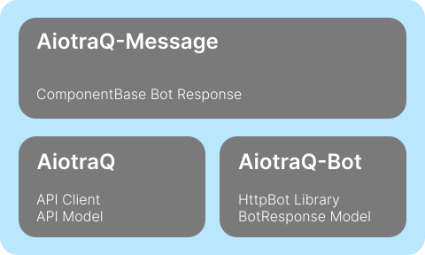

# AiotraQ

async ready API wrapper and bot library for [traQ](https://github.com/traPtitech/traQ) written in Python.

[](https://pypi.org/project/aiotraq/)
[](https://pypi.org/project/aiotraq-bot/)
[](https://pypi.org/project/aiotraq-message/)
[](https://github.com/toshi-pono/aiotraq/actions/workflows/ci.yml)
[](https://github.com/toshi-pono/aiotraq/blob/main/LICENSE)


## Installation

```bash
pip install aiotraq
pip install aiotraq-bot
pip install aiotraq-message
```

## Projects

詳細は各リンク先を参照してください。

| Name                                                                            | Description                              | Version                                                                                                                             |
| ------------------------------------------------------------------------------- | ---------------------------------------- | ----------------------------------------------------------------------------------------------------------------------------------- |
| [AiotraQ](https://github.com/toshi-pono/aiotraq/tree/main/libs/aiotraq)         | 非同期リクエスト対応の traQ API ラッパー | [](https://pypi.org/project/aiotraq/)                         |
| [AiotraQ-Bot](https://github.com/toshi-pono/aiotraq/tree/main/libs/bot)         | FastAPI を使った traQ Bot ライブラリ     | [](https://pypi.org/project/aiotraq-bot/)             |
| [AiotraQ-Message](https://github.com/toshi-pono/aiotraq/tree/main/libs/message) | traQ Bot のメッセージ送信ライブラリ      | [](https://pypi.org/project/aiotraq-message/) |



ドキュメントは [こちら](https://toshi-pono.github.io/aiotraq/docs/intro/)

## Development

`main` tracks the 0.3 series; all three packages require Python 3.11 or newer.
The `v0.2` maintenance branch retains Python 3.8+ for `aiotraq` and Python 3.10+
for `aiotraq-bot` / `aiotraq-message`. See [SECURITY.md](SECURITY.md) for the
limitations of the compatibility release and [RELEASING.md](RELEASING.md) for
the two release workflows.

Use Poetry 2.4.1, running under Python 3.11 or newer:

```bash
poetry config virtualenvs.in-project true --local
poetry install --with dev,api
make lint
make test
```

Poetry's interpreter is separate from the Python versions supported by the
distributed libraries. CI builds all three wheels together and tests clean
installations rather than relying only on editable development installs.

### aiotraq

API Client の更新: monorepo のプロジェクトルートで以下を実行してください

```bash
poetry install
make api_update
```

> [!WARNING]
> `post_webhook` についてはライブラリ未対応のため動的に生成できず、手動で追加しています

API regeneration is a separately reviewed change: it can replace generated
files, including the manually maintained webhook endpoint. The security update
preserves the existing generated client. The patched generator uses its own
escaped code templates; only project metadata, README and version exports are
customized. `python scripts/check_generator.py` exercises generation, escaping
and multipart uploads in a temporary directory. API regeneration is disabled
on `v0.2`; backport reviewed compatible changes from `main` instead.

## publish

Releases require maintainer review before publishing. See
[RELEASING.md](RELEASING.md) for preparation, validation and publication.

`make write-version VERSION=0.3.0` synchronizes the root, three packages,
generator configuration and documentation metadata. Refresh the root Poetry
lock afterward and run `make check-version`. The release workflow defaults to
`prepare`, which builds and verifies artifacts without uploading them to a
package index. TestPyPI and PyPI each require an explicit selection.

## License

This project is licensed under the terms of the MIT license.
