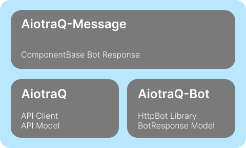

# Introduction

⚡️ AiotraQ は Python で traQ Bot を高速に開発するためのライブラリです



AiotraQ は 3 つのライブラリから構成されていて、それぞれ以下の機能を提供しています

- [aiotraq](https://github.com/toshi-pono/aiotraq/tree/main/libs/aiotraq): 非同期リクエスト対応の traQ API ラッパー
- [aiotraq-bot](https://github.com/toshi-pono/aiotraq/tree/main/libs/bot): FastAPI を使った traQ Bot ライブラリ
- [aiotraq-message](https://github.com/toshi-pono/aiotraq/tree/main/libs/message): traQ Bot のメッセージ送信ライブラリ

## インストール

0.3 系は Python 3.11 以上が必要です。

```bash
pip install aiotraq
pip install aiotraq-bot
pip install aiotraq-message
```

## 0.2 系からの更新

0.3 系へ更新する場合は Python 3.11 以上で仮想環境を作り直し、3 パッケージと依存ライブラリを更新してください。

```bash
python3.11 -m venv .venv
source .venv/bin/activate
python -m pip install --upgrade "aiotraq>=0.3,<0.4" "aiotraq-bot>=0.3,<0.4" "aiotraq-message>=0.3,<0.4"
python -m pip check
```

依存関係を lock ファイルやコンテナに固定している場合は、それらも更新して再デプロイします。
`main` は 0.3 系以降、[`v0.2` ブランチ](https://github.com/toshi-pono/aiotraq/tree/v0.2) は 0.2 系の保守に使用します。

Python 3.10 を維持する Bot・メッセージ利用環境では、0.2 系を明示してインストールしてください。
API クライアント単体の 0.2 系は Python 3.8 以上に対応します。

```bash
python -m pip install --upgrade "aiotraq>=0.2.6,<0.3" "aiotraq-bot>=0.2.6,<0.3" "aiotraq-message>=0.2.6,<0.3"
```

0.2 系では古い Python に対応する依存ライブラリの修正版が提供されない場合があります。
残る制約は [セキュリティ方針](https://github.com/toshi-pono/aiotraq/blob/v0.2/SECURITY.md) を確認し、可能な環境では 0.3 系へ移行してください。

## アプリケーション例

Bot がメッセージを受信したら、メッセージを返信する例

```python
import os
import asyncio
from aiotraq_bot import TraqHttpBot
from aiotraq_message import TraqMessage, TraqMessageManager


async def component(am: TraqMessage, payload: str):
    am.write(payload)
    # long task
    with am.spinner():
        await asyncio.sleep(3)
    am.write(":done: Done!")

bot = TraqHttpBot(verification_token=os.getenv("BOT_VERIFICATION_TOKEN"))
response = TraqMessageManager(bot, os.getenv("BOT_ACCESS_TOKEN", ""), "https://q.trap.jp/api/v3", "https://q.trap.jp")


@bot.event("MESSAGE_CREATED")
async def on_message_created(payload) -> None:
    channel_id = payload.message.channelId
    message = payload.message.plainText

    await response(component, channnel_id=channel_id, payload=message)

if __name__ == "__main__":
    bot.run(port=8080)
```

## Guides

- [アプリケーション例](/docs/guides/app-example)
- [Bot サーバーの作成](/docs/guides/bot-guide)
- [動的メッセージの作成](/docs/guides/message-guide)
- [API Clientの利用](/docs/guides/api-guide)
- [NeoShowcaseへのデプロイ](/docs/guides/ns-deploy)

## API reference

- [イベント一覧](/docs/api/bot-event/)
- [メッセージコンポーネント](/docs/api/components/overview)
